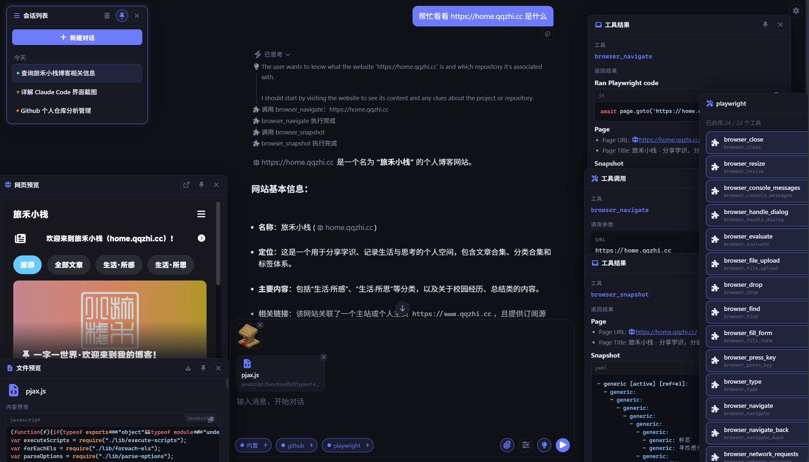
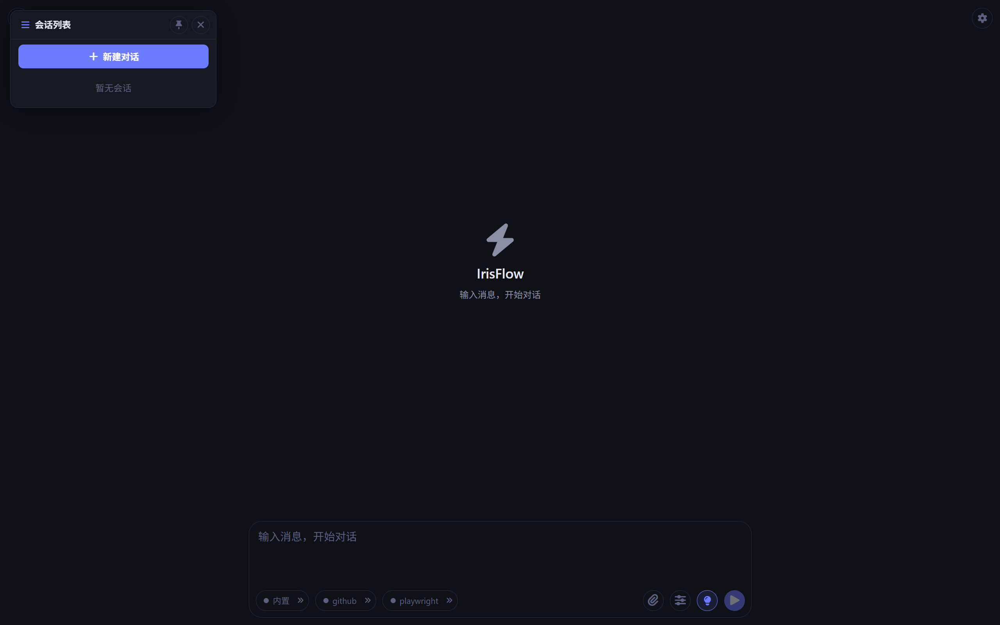
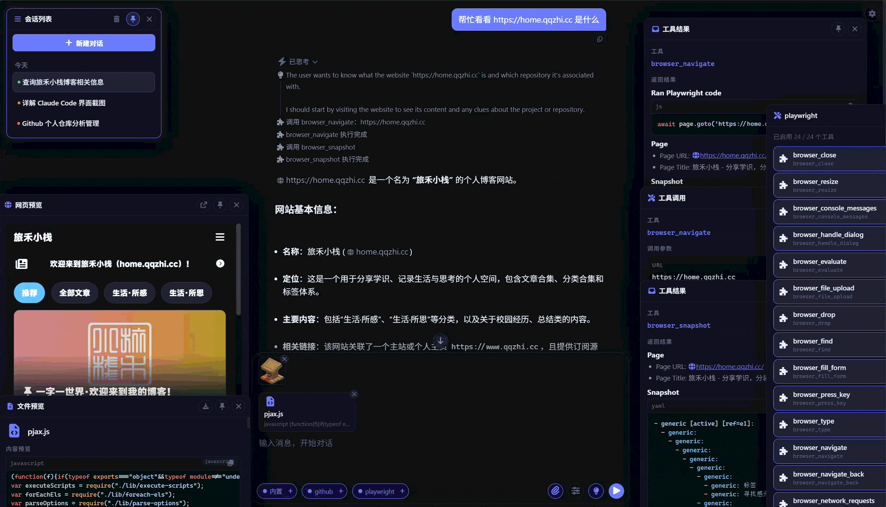
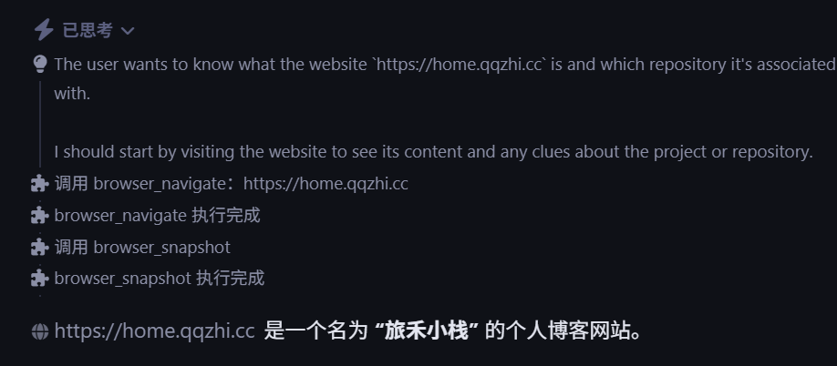
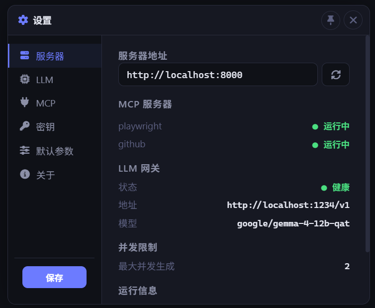
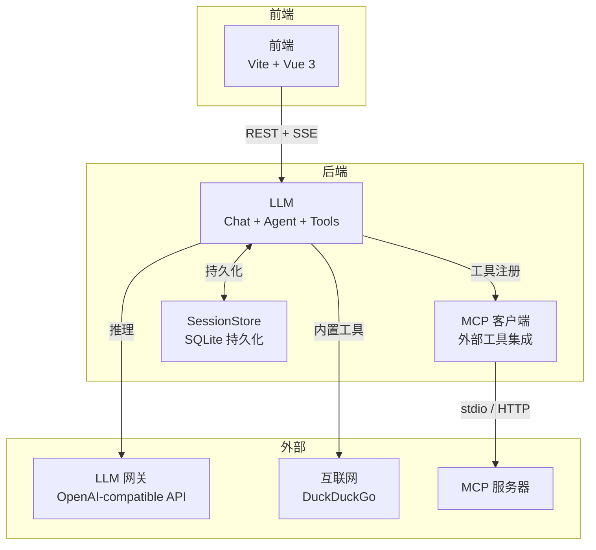

# IrisFlow

<p align="center">
  
</p>

**IrisFlow** 是一个 LLM Chat + Agent 控制台。后端基于 FastAPI 提供 OpenAI-compatible 网关，前端基于 Vite + Vue 3 提供聊天面板。支持流式对话（SSE）、Agent 工具调用推理循环、MCP 外部工具集成、会话持久化与多格式文件上传。开发测试全程基于 LM Studio 本地部署 `google/gemma-4-12b-qat`。

[]()
[]()
[]()
[]()
[]()
[]()
[]()
[]()


## ✨ 功能

- **浮窗式布局** — 会话列表、设置、工具管理、工作流详情均为独立浮窗，可拖拽、置顶、自由排列工作区，不受固定面板束缚
- **多会话并行生成** — 同时向多个会话发送消息，各自独立推理互不阻塞，充分利用并发能力
- **Agent 推理时间线** — 思考过程 → 工具调用 → 返回结果逐步展开，图标 + 竖线连接，让模型推理过程透明可视
- **实时状态灯** — 会话列表每项四色圆点：🟢 可发送 / 🟡 生成中（脉冲）/ 🔴 排队中 / ⚫ 未知，SSE 实时同步
- **一键预设** — 精确 / 日常 / 创作 三档参数胶囊，点击即切换温度与采样策略，无需手动调参
- **统一媒体预览** — 拖拽上传 90+ 格式，图片缩略图、文档自动转 Markdown，统一浮窗预览
- **随时中止生成** — 点击停止按钮立即中断 LLM 调用，无需等待完成
- **断连自动恢复** — 与后端断开时全屏遮罩提示，恢复后自动重连，生成中的会话无缝续传
- **自动标题** — LLM 根据对话内容自动生成标题，无需手动命名
- **MCP 工具管理** — 按服务器分组开关工具，支持搜索筛选，运行时即时生效

## 🛠️ 技术栈

| 层 | 技术 | 说明 |
|----|------|------|
| **前端** | Vite + Vue 3 + TypeScript | Agent 控制台 |
| **后端框架** | FastAPI (Python 3.14) | RESTful API |
| **包管理** | uv (Python) / pnpm (Node.js) | 依赖与项目管理 |
| **LLM 网关** | OpenAI-compatible API | Chat + Agent 推理（流式 / 思考 / 工具调用） |
| **工具引擎** | DuckDuckGo / trafilatura / MCP | 内置工具 + 外部 MCP 服务器集成 |
| **会话持久化** | SQLite | 会话上下文重启后自动恢复 |

## 🚀 快速开始

### 环境要求

| 工具 | 版本 | 用途 |
|------|------|------|
| [Python](https://www.python.org/downloads/) | **3.14** | 后端运行时 |
| [uv](https://docs.astral.sh/uv/) | 最新版 | Python 包管理 |
| [Node.js](https://nodejs.org/) | **24** | 前端运行时 |
| [pnpm](https://pnpm.io/installation) | 最新版 | Node 包管理 |
| [Git](https://git-scm.com/) | 最新版 | 版本控制 |

### 1. 安装依赖

```bash
# 后端
cd backend && uv sync

# 前端
cd frontend && pnpm install

# 根目录（统一启动脚本）
cd .. && pnpm install
```

### 2. 开发模式（一键启动）

```bash
pnpm dev
```

前后端同时启动，Vite 自动将 `/api` 代理到后端。访问 `http://localhost:3000`。

### 3. 生产模式

```bash
pnpm start   # 构建前端 → 后端 serve 静态文件
```

后端统一在 `http://localhost:8000` 提供 API + 前端页面，单端口访问。

> 开发时也可分开启动：`cd backend && uv run uvicorn main:app --reload` + `cd frontend && pnpm dev`。

### 验证安装

```bash
# 测试后端根接口
curl http://localhost:8000/
# → {"name":"IrisFlow","version":"0.0.6",...}

# 测试健康检查
curl http://localhost:8000/api/health
# → {"status":"healthy","base_url":"...","default_model":"..."}
```

## 📸 界面预览

<p align="center">
  <table>
    <tr>
      <td align="center"><b>开始界面</b></td>
      <td align="center"><b>主界面</b></td>
    </tr>
    <tr>
      <td></td>
      <td></td>
    </tr>
    <tr>
      <td align="center"><b>Agent 推理</b></td>
      <td align="center"><b>设置面板</b></td>
    </tr>
    <tr>
      <td></td>
      <td></td>
    </tr>
  </table>
</p>

## ⚙️ 配置

首次启动后，在设置面板（⚙️）中完成配置。所有配置持久化到 `backend/data/*.json`。

### 本地部署（推荐）

IrisFlow 开发测试全程使用 [LM Studio](https://lmstudio.ai/) 本地推理，无需云端 API，数据不出本机。

**1. 安装 LM Studio** → 下载 `google/gemma-4-12b-qat` 或其他支持工具调用的模型 → 启动本地推理服务。

**2. 在 LM Studio 中加载模型后**，将 LLM 配置指向本地地址：

```jsonc
// backend/data/llm_config.json
{
  "base_url": "http://localhost:1234/v1",
  "auth_token": "${LLM_TOKEN}",      // LM Studio 默认无需 token，留空即可
  "model": "google/gemma-4-12b-qat", // 需与 LM Studio 中加载的模型名一致
  "max_concurrent": 2                // 本地模型建议 1~2，视显存调整
}
```

> **模型要求**：需支持工具调用（tool calling），Gemma 4 12B、Qwen 3 14B+、Llama 4 等均可。纯聊天模型可用于 Chat 模式，但 Agent 模式需要工具调用能力。

### 云端 API

也兼容任意 OpenAI-compatible API，修改 `base_url` 和 `auth_token` 即可：

```jsonc
{
  "base_url": "https://api.deepseek.com/v1",
  "auth_token": "${DS_TOKEN}",
  "model": "deepseek-v4-pro"
}
```

### MCP 服务器（可选）

JSON 格式配置外部工具服务器，支持 stdio 子进程和 Streamable HTTP 两种传输，运行时增删即刻生效。

### 密钥变量

支持 `${VAR_NAME}` 占位符，在 LLM / MCP 配置中引用，实际值存储在 `secrets.json` 中，请求时自动替换。

```jsonc
// backend/data/secrets.json
{
  "LLM_TOKEN": "sk-xxx",
  "DS_TOKEN": "sk-xxx",
  "GITHUB_MCP_PAT": "github_pat_xxx"
}
```

## 📂 项目结构

```
IrisFlow/
├── backend/
│   ├── main.py                  # 入口，挂载路由 + lifespan（MCP 自动连接 + 有序关闭）
│   ├── models.py                 # 共享数据模型（跨模块类型定义）
│   ├── core/                    # config.py（配置单例 + JSON 持久化） / info.py（系统信息端点）
│   ├── llm/                     # LLM — Chat + Agent + Tools + MCP
│   │   ├── client.py             #   LLM 网关客户端（OpenAI-compatible，流式 + 工具调用累积 + 健康探测）
│   │   ├── chat.py               #   Chat 类 — 消息历史容器
│   │   ├── agent.py              #   Agent(Chat) — 工具调用推理循环（自定义工具暂停/继续）
│   │   ├── tools/                  #   工具包（注册表 + 执行器 + 每工具独立模块）
│   │   │   ├── __init__.py         #     ToolExecutor 单例 + BUILTIN_TOOLS 注册
│   │   │   ├── base.py             #     Tool 抽象基类
│   │   │   ├── web_search.py       #     网页搜索工具
│   │   │   ├── calculator.py       #     计算辅助工具
│   │   │   └── open_url.py         #     打开网页工具
│   │   ├── mcp.py                #   MCP 客户端 — stdio + HTTP MCP 服务器发现 + 工具注册
│   │   ├── sessions.py           #   SessionStore — SQLite 持久化
│   │   ├── uploads.py             #   文件上传 — 类型判定 + 内容提取 + MarkItDown 转换
│   │   ├── constants.py          #   全模块共享常量（会话状态、消息角色、SSE 事件类型）
│   │   ├── models.py             #   Pydantic 模型（Chat/Agent/Tool/会话）
│   │   └── router.py             #   REST 路由 + 统一队列调度 + LLM 健康门控
│   ├── data/                     # SQLite 数据库 + JSON 配置文件（LLM / MCP / 密钥 / 默认参数）
│   ├── pyproject.toml
│   └── pyrightconfig.json
├── frontend/                    # 前端（Vite + Vue 3）
│   ├── src/
│   │   ├── App.vue               #   根组件 — 会话列表 + 聊天面板 + 动态浮窗 + 心跳
│   │   ├── main.ts               #   入口
│   │   ├── style.css             #   全局样式（深色主题 + CSS 变量）
│   │   ├── api/client.ts         #   fetch 封装 + SSE 流式 + 可配置后端地址
│   │   ├── env.d.ts               #   TypeScript 环境声明（CSS 模块等）
│   │   ├── types/api.ts          #   TypeScript 接口（映射后端 Pydantic 模型）
│   │   ├── constants.ts          #   全模块共享常量
│   │   ├── router.ts              #   Vue Router history 模式
│   │   ├── composables/          #   useAgent + drafts + toolMetadata + injectionKeys + windowZIndex
│   │   ├── utils/                #   纯函数 + Markdown 渲染 + 媒体类型判定
│   │   └── components/           #   Vue SFC 组件
│   │       ├── floating/          #     浮窗子窗体（全部基于 FloatingWindow 框架）
│   │       │   ├── FloatingWindow.vue    #     通用浮窗框架 — 可拖拽 + 置顶 + 视口约束
│   │       │   ├── ConversationList.vue  #     会话列表 — 分组 + 置顶 + 重命名 + 删除 + 状态灯
│   │       │   ├── SettingsPanel.vue     #     设置面板 — 标签页式（服务器/LLM/MCP/密钥/默认参数/关于）
│   │       │   ├── ToolGroupPanel.vue    #     工具管理浮窗 — MCP 服务器工具组开关
│   │       │   ├── WorkflowDetail.vue    #     工作流详情 — 工具调用 / 结果 / 思考过程查看
│   │       │   └── MediaPreview.vue      #     统一媒体预览 — iframe 图片/视频/网页 + 文件 Markdown 渲染
│   │       ├── ChatPanel.vue      #     聊天面板 — 消息滚动 + 会话加载
│   │       ├── ChatInput.vue      #     输入框 — 工具切换 + 思考开关 + 文件上传
│   │       ├── MessageBubble.vue  #     消息气泡 — Markdown 渲染 + 思考过程
│   │       ├── SessionSettingsPanel.vue  #  会话参数面板 — 预设胶囊 + 基础/高级标签页
│   │       ├── WorkflowLog.vue    #     工作流日志 — Agent 推理步骤时间线
│   │       └── ImageViewer.vue    #     图片缩略图组件
│   ├── vite.config.ts            #   Vite 配置 + /api 反向代理
│   └── package.json
└── README.md
```

## 🏗️ 架构

IrisFlow 采用前后端分离设计，核心是 LLM 模块（Chat + Agent + Tools + MCP），提供完整的 LLM 推理基础设施。

**关键设计原则：**

- **后端是状态的唯一权威源** — 前端不自行推断会话状态，所有状态由 SSE 实时推送
- **会话 ≠ 对话** — 会话（Session）是聊天记录容器，单轮交互（Message Round）是会话内的用户↔LLM 往返
- **统一 FIFO 队列** — 多会话入队调度，LLM 健康门控 + 并发控制，`asyncio.shield()` 保护状态落盘
- **插件式工具系统** — `Tool` 抽象基类 + `ToolExecutor` 单例注册，内置工具与 MCP 外部工具统一管理、独立开关



### 后端

#### LLM — Chat + Agent + Tools

核心 LLM 基础设施，包含以下子模块：

- **Chat**（`llm/chat.py`）— 消息历史管理，流式/非流式调用。
- **Agent**（`llm/agent.py`）— 继承 Chat，增加工具调用推理循环。`run_stream()` 产出流式事件，`continue_with_results()` 实现多轮工具推理。
- **Tools**（`llm/tools/`）— `ToolExecutor` 单例管理工具注册与执行。3 个内置工具：`web_search`（DuckDuckGo）、`open_url`（trafilatura 智能抓取）、`calculator`（安全 eval + 数学函数），每工具独立模块。支持通过 `register()` 动态注入外部工具。
- **MCP**（`llm/mcp.py`）— `MCPManager` 单例，标准 MCP 协议（JSON-RPC 2.0 over stdio/HTTP），运行时增删 + 文件监听热重载。
- **Client**（`llm/client.py`）— OpenAI-compatible API 封装。`chat_stream_events()` 产出带类型的 SSE 事件（`reasoning`/`content`/`tool_calls`），支持流式工具调用增量累积。
- **Sessions**（`llm/sessions.py`）— `SessionStore` 提供 SQLite 持久化会话管理，`asyncio.Lock` 守护，重启后自动恢复全部会话。

### 前端

IrisFlow 的 Web 控制台，集成工具切换、思考模式、文件上传、会话管理等功能。

**功能概览：**

| 功能 | 说明 |
|------|------|
| 流式聊天 | SSE 实时推送 reasoning / content / tool_call / tool_result 事件 |
| 工具切换 | 输入框工具按钮（网页搜索 / 打开网页 / 计算辅助），独立开关 |
| 思考模式 | thinking 开关，流式展示思考过程 |
| 文件上传 | 90+ 文件类型，图片 → base64，文档 → MarkItDown Markdown |
| 会话管理 | 会话列表按日期分组，支持置顶 / 重命名 / 删除，SSE 实时状态同步 |
| 工作流日志 | Agent 推理步骤可视化（思考 → 工具调用 → 结果），左列图标 + 竖线时间线 |
| Markdown 渲染 | markdown-it + KaTeX 公式 + highlight.js 代码高亮 |
| 设置面板 | 标签页式（服务器 / LLM / MCP / 密钥 / 默认参数 / 关于），配置持久化 |

**架构分层：**

```
┌──────────────────────────────────────────┐
│                   控制台                 │
├──────────────────────────────────────────┤
│  Components   ChatPanel / ConversationList / … │
├──────────────────────────────────────────┤
│  Composables  useAgent（统一 chat+agent）  │
│               drafts                      │
├──────────────────────────────────────────┤
│  API Layer    fetch + SSE → :8000         │
└──────────────────────────────────────────┘
```

| 层 | 技术选型 | 说明 |
|----|----------|------|
| 框架 | Vite 8 + Vue 3 + TypeScript | SPA，无 SSR |
| HTTP 客户端 | 原生 fetch | 封装在 `api/client.ts`，类型化 API 函数 |
| 实时通信 | SSE（Server-Sent Events） | 流式推理 + 状态推送 |
| 状态管理 | Vue 3 响应式 + 内存草稿 | 页面刷新后草稿消失 |
| Markdown | markdown-it + KaTeX + highlight.js | 公式渲染 + 代码高亮 |

## 📄 许可证

本项目基于 [Ryoine 非商业公共许可证 1.0（RNCL-1.0）](./LICENSE.md) 许可。源代码仅供个人非商业使用。商业用途、企业部署、二次分发等须取得单独书面授权。

## 🤝 参与贡献

Bug 报告、功能提案、代码贡献请参阅 [CONTRIBUTING.md](./CONTRIBUTING.md)。
